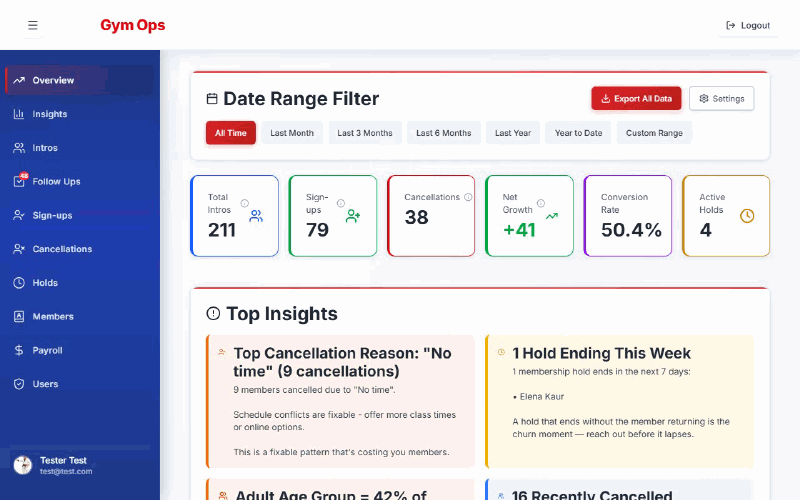
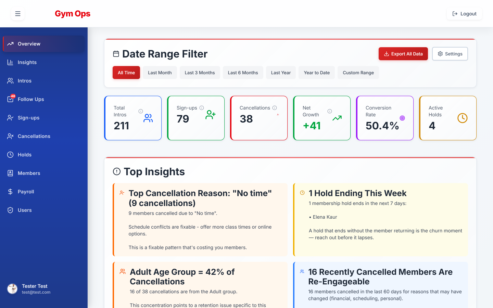
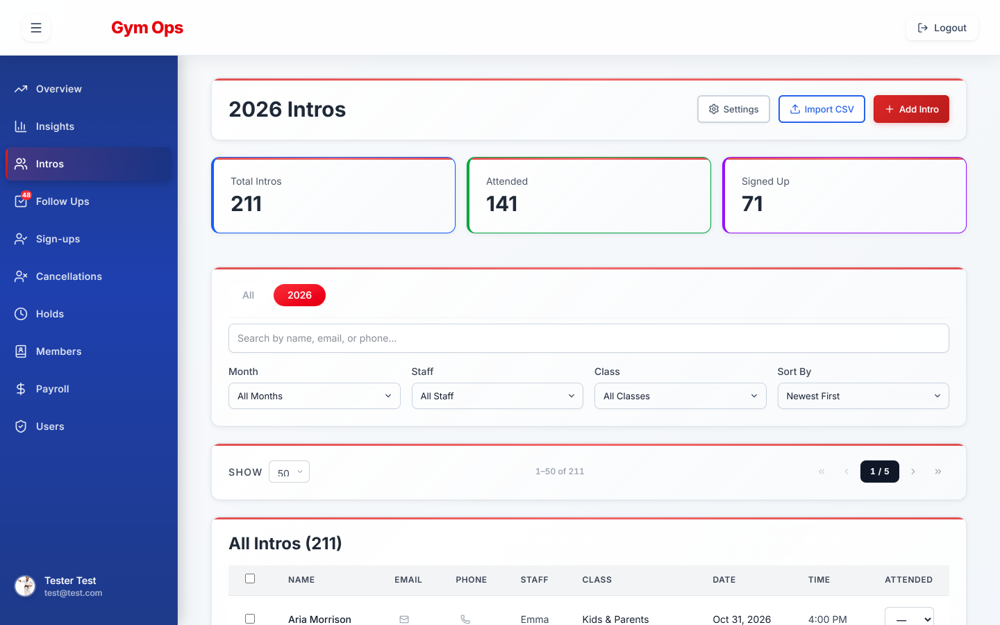
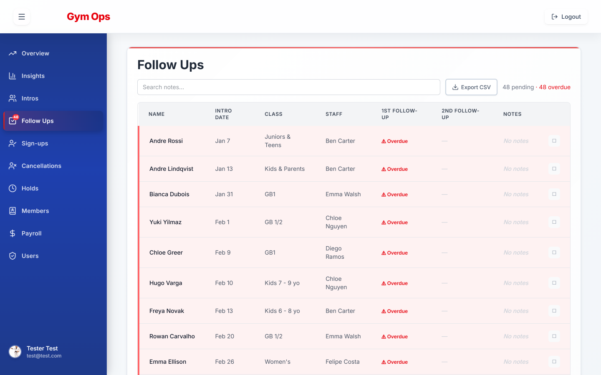
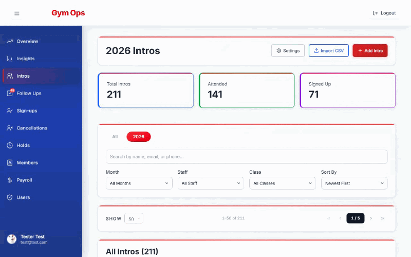
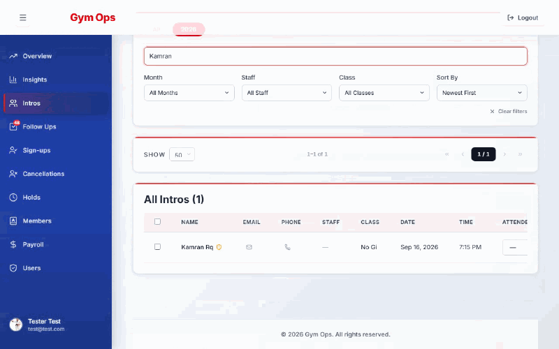
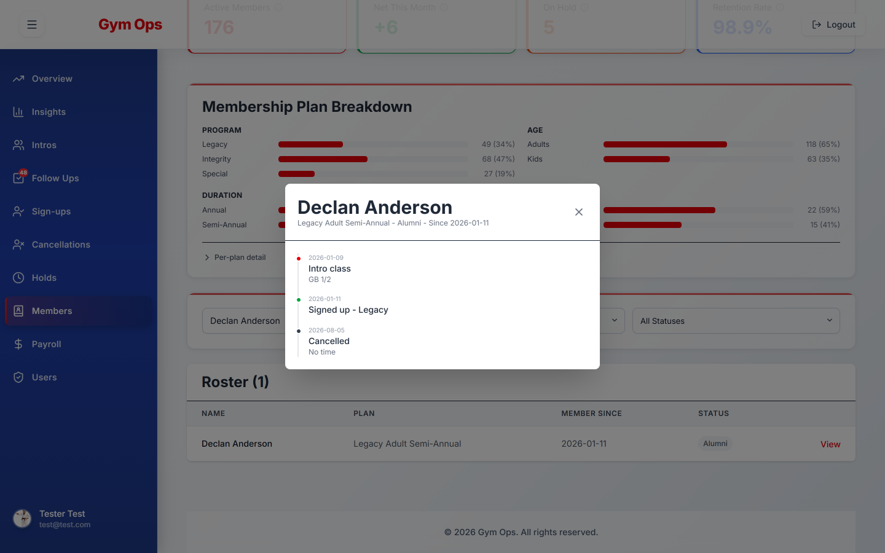
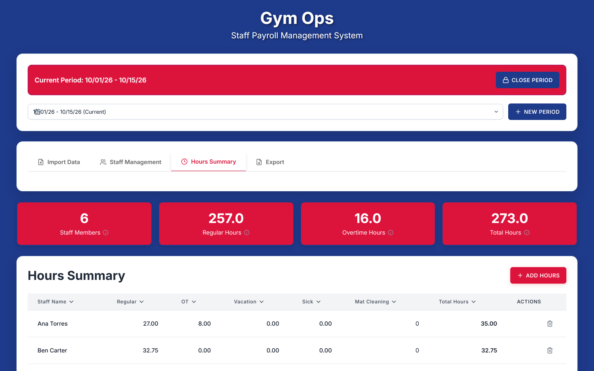
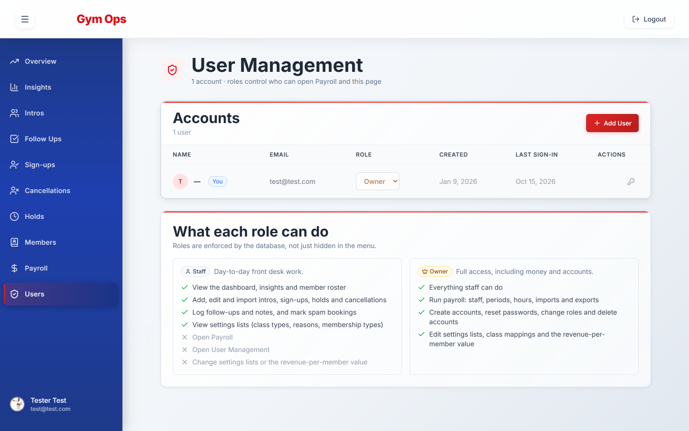

# Gym Operations & Management System


One place to run a membership gym: every prospect's trial class, the follow-ups that turn them into members, sign-ups, holds, cancellations, the member roster, insights on what's working, and staff payroll at the end of the period.



> Everything shown here is fictional demo data from [`demo-data/`](demo-data/). Names use made-up people, emails use the reserved `example.com` domains, and phones use the reserved `555-01xx` block.

---

## Why it exists

I built this while working as program director at a Brazilian jiu-jitsu gym in Vancouver (Gracie Barra Kitsilano). The operation lived in a pile of disconnected Excel and Google Sheets files. A question like "how many people signed up in March versus cancelled in April?" meant opening three files and doing the math by hand, and nobody could say which trial-class leads had been followed up.

This replaced the spreadsheets. It runs the gym day to day, which meant real data, real edge cases, and constraints you don't hit in a tutorial project.

---

## How it works

A member's life in the gym has four stages, and each has its own tab:

```
Intro (trial class) ──► Sign-up ──► Hold (pause) ──► Cancellation
        │                                                 │
        └──── follow-ups until they decide ───────────────┘── can come back as a new intro
```

Every tab works the same way: filter, search, import a CSV, edit inline. The tabs feed each other. Importing a sign-up marks that person's intro as converted, a cancellation closes any active hold, and someone who cancelled and books a new trial class gets flagged as a returning former member.

### Overview and insights

The dashboard answers "how are we doing?" at a glance: intros, sign-ups, cancellations, net growth, conversion rate and active holds for any date range. Below that, the system writes its own observations from the data, such as the top cancellation reason, holds ending this week, or members who cancelled recently for reasons that may have changed. Each insight can be marked done, snoozed or dismissed, and it comes back if the numbers shift again.



### Intros and follow-ups

A prospect's free trial class is an intro. Staff record whether they attended and signed up, and the Follow Ups tab lists every lead still waiting on a decision, with a timestamped note for each contact attempt so nobody falls through the cracks.





### Importing a spreadsheet

The gym's history came from spreadsheets, so every tab imports CSV. The preview shows exactly what will be written, duplicates are skipped, and the last import can be undone. Dates written as `MM/DD` with no year get the year you confirm, so old records are never stamped with the wrong one.



### Spam bookings

The online booking form attracts junk. Each imported booking is scored for spam signals (foreign phone formats, emails with long strings of digits, one-word or slang names), and a shield marks suspect rows. One click shows why a booking was flagged. Marking it as spam hides it from every count and strongly flags any later booking from the same email or phone. The action can be undone.



### Members and their journey

The roster syncs from the billing system's CSV export. A member's status (Active, On Hold, Alumni) isn't copied from that export. It's derived from the gym's own records, comparing the latest sign-up with the latest cancellation and any active hold. The journey view puts every touchpoint for one person on a single timeline.



### Payroll

Owners enter staff hours by pay period: regular, overtime, vacation, sick and mat-cleaning bonuses. Hours can be typed in, pasted as quick text, or imported from CSV, where the app works out whether the file holds staff or hours from its columns. The export matches the accountant's exact column format and staff order, and a format editor adapts it if their template changes.



### Roles

There are two roles. **Staff** handle the day-to-day work. **Owners** also get payroll, account management and settings. The rules are enforced in the database with Row Level Security, not just hidden in the menu, and a database trigger stops anyone from promoting their own account. Owners manage accounts and roles from the Users page, which spells out what each role can do.



### Automated imports

The billing and booking system has no public API on the gym's plan, but it does send notification emails. Scheduled importers read those emails through the Gmail API and turn bookings, holds and cancellations into records. They're deduplicated on natural keys, existing records are enriched rather than duplicated, and class names are translated through a mapping table staff can extend from the UI.

---

## Tech stack

| | |
|---|---|
| **Next.js 15** (App Router) | Server and client components in one project, with dashboard, payroll, profile and admin pages |
| **TypeScript** (strict) | Caught real bugs before runtime, especially in CSV parsing and date handling |
| **Supabase** | PostgreSQL with Row Level Security on every table; every schema change is a versioned SQL migration |
| **Tailwind CSS v4** | No component library. Table, Modal, filters and the rest are custom |
| **Zustand** | Filter, UI, selection and sidebar state |
| **Zod** | Validates form input and every CSV row before it reaches the database |
| **Recharts** | Charts on the Overview and Insights tabs |
| **Jest + Playwright** | Unit, schema and end-to-end tests |
| **ESLint + Biome** | Zero-warning lint gate, plus a pre-commit hook through Husky and lint-staged |

---

## Project structure

```
app/
├── api/
│   ├── cron/            # Gmail importers, keep-alive, follow-up auto-marker
│   ├── members/import/  # Member roster CSV sync
│   └── admin/           # Account and role management (owner only)
├── components/
│   ├── layout/          # Header, sidebar, navigation
│   ├── tabs/            # One component per feature tab, with forms/ and modals/
│   ├── payroll/         # Hours entry, periods, import, export, staff
│   └── ui/              # Shared Table, Modal, FilterBar, PaginationBar, ...
├── hooks/               # Data hooks: useIntros, useSignups, useInsights, ...
├── lib/
│   ├── supabase/        # Database queries, one file per table
│   ├── services/        # Email parsers, payroll import and export, CSV formats
│   ├── spam/            # Spam signal detection for bookings
│   └── csv.ts           # CSV parsing for every record type
├── store/               # Zustand stores
└── types/               # Shared TypeScript types

demo-data/               # Fictional CSVs for every import, plus their generator
docs/                    # SRS, SDD, database reference, test plan, README media
e2e/                     # Playwright end-to-end specs
supabase/migrations/     # Versioned SQL migrations
```

Every tab follows the same pattern: a hook fetches and caches the data, the tab handles filtering and selection, and its forms and modals sit next to it. That made new tabs cheap to add.

The email importers run on an external scheduler that calls the `/api/cron/*` endpoints with a bearer secret, and two housekeeping jobs run on Vercel cron. Every scheduled endpoint is idempotent, so re-runs are safe.

---

## Run it yourself

### You need

- Node.js 20
- A free [Supabase](https://supabase.com) project
- The Supabase CLI (`npx supabase` works without installing it)

### 1. Install

```bash
git clone https://github.com/SuzanoVini/gym-management-system.git
cd gym-management-system
npm install
cp .env.example .env.local
```

### 2. Connect your Supabase project

Fill in `.env.local` from your project's **Settings → API** page:

```env
NEXT_PUBLIC_SUPABASE_URL=https://<project-ref>.supabase.co
NEXT_PUBLIC_SUPABASE_ANON_KEY=<anon key>
SUPABASE_SERVICE_ROLE_KEY=<service role key>   # server only: account management
CRON_SECRET=<any random string>
```

The `GMAIL_*` variables are only needed for the automated email importers. Leave them blank to run everything else.

### 3. Create the database

```bash
npx supabase link --project-ref <project-ref>
npx supabase db push
```

### 4. Create your owner account

In the Supabase dashboard, add a user under **Authentication → Users**. New accounts start as staff, so promote yours in the **SQL Editor**:

```sql
update user_profiles set role = 'owner'
where id = (select id from auth.users where email = 'you@example.com');
```

### 5. Add your branding (optional)

The app ships without any gym's logo or name and shows "Gym Ops" until you set your own. Drop your images in `public/brand/` and point the `NEXT_PUBLIC_BRAND_*` variables at them. [`public/brand/README.md`](public/brand/README.md) has the two-minute version.

### 6. Start it and load the demo data

```bash
npm run dev
```

Open [localhost:3000](http://localhost:3000) and log in. To fill the app with the same fictional data shown above, import the files in [`demo-data/`](demo-data/) in the order its [README](demo-data/README.md) lists: intros, sign-ups, holds, cancellations, members, then payroll.

---

## Testing

| Command | What it runs |
|---------|--------------|
| `npm test` | Jest unit and schema suites |
| `npm run test:coverage` | Unit tests with the enforced 70% coverage floor |
| `npm run e2e` | Playwright end-to-end suite (needs `TEST_EMAIL` and `TEST_PASSWORD` for a test login) |
| `npm run quality` | Lint, Biome, typecheck and tests: the same gate CI runs on every push |

The reasoning behind what gets tested at which layer is in the [test plan](docs/test-plan.md).

---

## Documentation

- [Software Requirements Specification](docs/SRS.md): what the system must do, including the billing-system integration boundary
- [Software Design Document](docs/SDD.md): architecture, key decisions and trade-offs
- [Database Schema Reference](docs/database.md): tables, enums, triggers and the RLS model
- [Test Plan](docs/test-plan.md): the three-layer testing strategy

---

## What's next

- Fold in the after-school program pickup system (same Supabase project, `asp_`-prefixed tables, its own route section)
- Tighten the phone layout (some header buttons still overflow at narrow widths)
- Email reminders for intro follow-ups

---

## License

MIT. See [LICENSE](LICENSE).

---

## About

Built by **Vinicius Suzano**, Computer Information Systems, Vancouver, BC. [GitHub](https://github.com/SuzanoVini)
